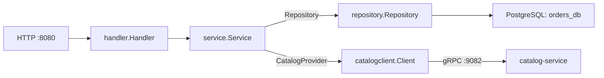

# Архитектура orders-service

Orders — отдельный процесс, Go-модуль и Git-репозиторий. Он владеет `orders_db`
и ролью `orders_app`. Внешний API использует HTTP/JSON, обращение к каталогу — gRPC.

## Слои и зависимости

`cmd/orders/main.go` собирает зависимости через `NewClient`, `NewRepository`,
`NewService`, `NewHandler` и `NewRouter`. Handler объявляет интерфейс Service;
бизнес-сервис объявляет интерфейсы Repository и CatalogProvider.

- `handler` читает HTTP/JSON, задаёт deadline и переводит ошибки в HTTP.
- `handler/dto` содержит внешние HTTP-модели и преобразования.
- `service` реализует создание и чтение заказов через интерфейсы зависимостей.
- `catalogclient` реализует CatalogProvider через gRPC: соединение, RPC, проверка
  ответа, преобразование protobuf в `model.MenuItem` и перевод ошибок.
- `transport/grpc/catalogv1` содержит только сгенерированный protobuf/gRPC-код.
- `model` хранит бизнес-типы и правила без HTTP, protobuf и pgx.
- `repository` выполняет SQL и управляет транзакциями; `repository/entity`
  отделяет форму строк БД от бизнес-моделей там, где требуется преобразование.
- `errors` содержит ошибки для проверки через `errors.Is`.
- `platform` содержит локальные конфигурацию и pgxpool.

Стрелки на схеме показывают вызовы во время работы. Service зависит от интерфейсов,
а конкретные repository и catalogclient передаются ему при запуске. Архитектурный
тест запрещает бизнес-слоям импортировать адаптеры, HTTP/gRPC и pgx и проверяет
отсутствие прямых импортов других сервисов. Данные каталога получаем через API,
а не чтением чужой БД.

## Создание заказа

1. Service нормализует запрос и вычисляет его хеш.
2. Сохранённый идемпотентный повтор возвращается до вызова каталога; изменение тела
   с тем же ключом приводит к конфликту.
3. CatalogProvider получает проверенные блюда и цены через gRPC. Этот сетевой
   вызов выполняется до транзакции записи заказа.
4. Service проверяет результат, рассчитывает сумму и формирует снимки позиций.
5. Repository атомарно сохраняет заказ, позиции, ключ идемпотентности и outbox-событие.

Имена и цены в старом заказе не меняются вслед за меню. Ошибка записи outbox
откатывает всю транзакцию. Параллельные запросы с одним ключом не создают дубликаты.
Чтение чужого заказа скрывается за той же ошибкой, что отсутствие заказа.

## Контракт и gRPC-клиент

Каталог владеет `api/proto/catalog/v1/catalog.proto`; orders хранит точную копию
и генерирует Go-код в своём модуле. Сгенерированные файлы входят в исходники;
обычная сборка не требует соседнего репозитория или генераторов. Общего go.work,
локального replace и Go-модуля контрактов нет.

Клиент создаётся один раз и переиспользуется горутинами. `grpc.NewClient` не проверяет
доступность сервера при создании: соединение устанавливается при RPC. На локальном
стенде используется gRPC без TLS. Вызов ограничен 500 мс и наследует отмену
и более ранний deadline исходного запроса. Сообщения ограничены 64 КиБ в обе стороны.
Настроенные политики retry отключены; прозрачные транспортные повторы возможны.

Отмена исходного запроса возвращается вызывающему коду. Если исходный запрос
ещё действует, а время ожидания каталога истекло, возвращается
`ErrCatalogUnavailable`. `InvalidArgument` и `NotFound` преобразуются в ошибки
orders; внутренние сообщения удалённого сервиса не раскрываются.

## Жизненный цикл и отказы

При остановке HTTP-серверу даётся время завершить запросы; после истечения срока
их контексты отменяются. Пул БД и соединение с каталогом закрываются при завершении
процесса. Close регистрируется только после успешного создания клиента.

`/healthz` проверяет процесс, `/readyz` — собственную БД orders. Отказ каталога
не запрещает чтение старого заказа и сохранённый повтор создания; новый заказ
получает 503. Это проверяет сквозной тест двух процессов с PostgreSQL.

## Текущая граница реализации

Рабочий путь использует PostgreSQL и gRPC. `repository/memory` сохранён вместе
с тестами и не подключён в main. Outbox уже записывается в БД, но публикация
в Kafka ещё не реализована: события остаются pending. Notifications и обработка
событий — следующий этап.
